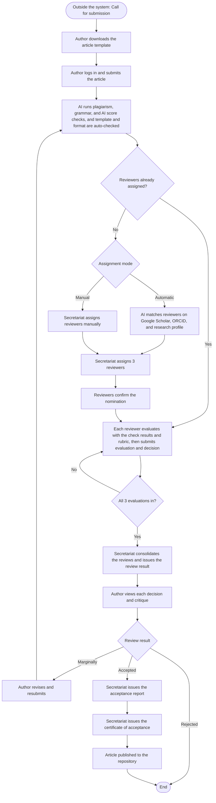

# CETRC Research Submission, Review, Workflow, and Decision Management System

A web-based system that streamlines the entire process of academic research submission at CETRC. It supports the complete review workflow, covering reviewer assignment, evaluation, revision cycles, approval decisions, notifications, and progress monitoring, from initial submission through to final decision. Instead of manually processing papers through emails, printed forms, or spreadsheets, the system tracks each step digitally and reduces delays and lost submissions.

Accepted studies are stored in a searchable digital repository.

**Team:** _add team members here_

## Table of Contents

1. [Features](#features)
2. [User Roles and Actors](#user-roles-and-actors)
3. [Use Cases (UML)](#use-cases-uml)
4. [IPO Chart](#ipo-chart)
5. [How the System Works](#how-the-system-works)
6. [Tech Stack](#tech-stack)
7. [Architecture](#architecture)
8. [AI Components](#ai-components)
9. [Database (ERD)](#database-erd)
10. [Setup](#setup)
11. [Build Order](#build-order)
12. [Methodology and Evaluation](#methodology-and-evaluation)
13. [Limitations](#limitations)
14. [Open Items to Confirm](#open-items-to-confirm)
15. [Data Privacy](#data-privacy)

## Features

- Role-based access for Authors, Reviewers, the Secretariat, and Admins
- Submission of the research article using the CETRC template (`template.CETRC`)
- Automated plagiarism, grammar, and AI score checks, plus automatic template and format checking, with results shown to the author and the reviewers
- Reviewer assignment by the Secretariat, either **automatic** (AI matches reviewers on Google Scholar, ORCID, and research profile) or **manual**
- Reviewers confirm their nomination before the review assignment is final
- Three reviewers critique each paper on methodology, template, format, citation, and content
- Reviewers can highlight words or paragraphs and attach labeled comments; the author clicks a label to see the feedback in a textbox
- Each reviewer decides **Accepted** (no revision), **Marginally** (revision), or **Rejected**
- The Secretariat consolidates the reviews and issues the review result
- The author views every reviewer's decision and critique, then revises and resubmits when needed
- Acceptance report and certificate of acceptance issued by the Secretariat; the author can view the acceptance report
- Revision history for every resubmission
- Searchable repository of published studies with view and download counts
- Notifications by email or within the platform
- Reports from the Secretariat
- Admin tools: manage users and roles, design the article format and template, and back up and restore data

## User Roles and Actors

| Actor | What they do |
|---|---|
| Author (student) | Submits the article, views check results, decisions, and critiques, revises and resubmits, and views the acceptance report |
| Reviewer | Confirms the reviewer nomination, evaluates the assigned article, and submits the evaluation and decision |
| Secretariat | Selects the assignment mode, assigns reviewers, consolidates the reviews and issues the review result, issues the acceptance report and certificate of acceptance, and generates reports |
| Admin | Manages users and roles, designs the article format and template, and backs up and restores data |
| AI System | Matches reviewers automatically and runs the plagiarism, grammar, and AI score checks |

The faculty adviser is recorded on each submission (`adviser_id`), but the use case diagram has no Adviser actor.

Roles are enforced with Spatie Laravel-Permission. Reviewers also keep a profile (Google Scholar, ORCID, research profile) that the automatic matching uses.

## Use Cases (UML)

Every human actor (Author, Reviewer, Secretariat, Admin) can **log in**.

| Actor | Use cases |
|---|---|
| Author | Submit research paper; View decisions and critiques; Revise and resubmit paper; View acceptance report |
| Reviewer | Confirm / accept reviewer nomination; Evaluate research paper; Submit evaluation and decision |
| Secretariat | Select assignment mode; Assign reviewers manually; Consolidate reviews and issue review result; Issue acceptance report; Issue certificate of acceptance; Generate reports |
| Admin | Manage users and roles; Design format and template; Data backup and restoration |
| AI System | Match reviewers automatically; Run plagiarism, grammar, and AI score checks |

## IPO Chart

### Author

| Input | Process | Output |
|---|---|---|
| Research article<br>Submitted article<br>Review comments<br>Revised article | Submit article<br>Run plagiarism, grammar, and AI score checks<br>Revise article<br>Resubmit article | Submission record<br>Automated check results<br>Revised article<br>Notification of resubmission |

### Secretariat

| Input | Process | Output |
|---|---|---|
| Submitted article, assignment mode, reviewer profiles, and AI-matched reviewer list<br>Completed review forms<br>Accepted review result<br>Accepted article<br>Submission, repository, and review records | Assign reviewers<br>Consolidate reviews<br>Issue acceptance report<br>Issue certificate of acceptance<br>Generate reports | Reviewer assignment records<br>Review result<br>Acceptance report<br>Certificate of acceptance<br>Reports |

### Reviewer

| Input | Process | Output |
|---|---|---|
| Reviewer nomination<br>Assigned article, automated check results, and rubric criteria<br>Completed evaluation | Confirm reviewer nomination<br>Evaluate article<br>Submit evaluation and decision | Confirmed review assignment<br>Rubric scores, annotations, and overall comments<br>Review form with decision |

### Admin

| Input | Process | Output |
|---|---|---|
| Account requests and role assignments<br>Format requirements, rubric criteria, categories, and programs<br>System database | Manage users and roles<br>Design format and template<br>Back up and restore data | User accounts with assigned roles<br>Article template<br>Data backup |

## How the System Works

The call for submission and the template download happen outside the system.



Because `review_forms` stores a `revision_id`, the same assigned reviewers evaluate each new revision, so a resubmission goes back to them after the automated checks.

AI features only assist. A human reviewer always makes the academic judgment.

## Tech Stack

| Layer | Technology |
|---|---|
| Backend | Laravel |
| Frontend | React, built into the Laravel project with Inertia.js (no separate React project) |
| Database | MySQL (XAMPP or Laragon for local development) |
| Roles and permissions | Spatie Laravel-Permission |
| Email | Laravel Notifications over Gmail SMTP with an App Password |
| File storage | Laravel local disk storage (`storage/app`) |
| AI microservice | Python with FastAPI |
| Reviewer matching and plagiarism | scikit-learn (TF-IDF and cosine similarity) |
| Template and format checks | python-docx and PyMuPDF |
| Grammar checking | LanguageTool |
| AI scoring | Groq API (Llama 3.3 70B) |
| Hosting | To be decided: school-provided capstone hosting first, otherwise a host that can run both Laravel and the Python service |

## Architecture

```
Browser (React)
      |
Laravel app (routes, auth, roles, workflow, notifications)
      |                         |
   MySQL                 HTTP / JSON
                                |
                  Python AI microservice (FastAPI)
                    |                   |
              LanguageTool          Groq API
```

- The browser only talks to Laravel.
- Laravel is the only part that calls the Python service, using Laravel's `Http` client.
- The microservice URL is set in `.env` (`AI_SERVICE_URL`), not hardcoded.
- If the AI service is slow or down, the submission flow must still work. Use timeouts and retries on the Laravel side.

Suggested folder layout (names are not final):

```
cetrc-project/
  cetrc-app/          Laravel + React (Inertia)
  cetrc-ai-service/   Python FastAPI microservice
```

## AI Components

These are the functions of the **AI System** actor in the use case diagram.

| Component | How it works | Status |
|---|---|---|
| Reviewer matching | TF-IDF and cosine similarity between a paper's abstract and keywords and each reviewer's research profile. Produces the AI-matched reviewer list for the Secretariat | Planned |
| Plagiarism check | TF-IDF and cosine similarity against papers already in CETRC's repository. Built in-house, no external provider | Planned |
| Grammar check | LanguageTool (public API for now, self-hosting recommended later to avoid rate limits) | Prototype script written |
| AI score | Groq Llama 3.3 70B scores the abstract against the rubric criteria as a suggestion for reviewers | Confirmed working in a standalone test script |
| Template and format check | Rule-based checks with python-docx or PyMuPDF against the CETRC template | Planned |

Planned endpoints: `/match-reviewers`, `/check-plagiarism`, `/check-grammar`, `/score-submission`, `/check-format`.

TF-IDF and cosine similarity are statistical text-matching techniques. Nothing is trained, so there is no dataset or model accuracy to report for them. Results are saved per revision in `automated_checks` with a score, a `threshold` cutoff, and a passed or flagged status.

## Database (ERD)

MySQL. Laravel migrations create the CETRC tables below. Laravel's standard `users` table uses `id` as its primary key; the CETRC foreign keys reference it. Each uploaded article version, including the first 6–8-page article, is stored as a revision.

| Table | Columns |
|---|---|
| users | id (PK), name, email, password, role |
| categories | id (PK), name |
| reviewer_profiles | id (PK), user_id (FK), google_scholar, orcid, research_profile |
| submissions | id (PK), author_id (FK), adviser_id (FK, nullable), category_id (FK), title, abstract, keywords, final_decision, status |
| revisions | id (PK), submission_id (FK), version_number, file_path, submitted_at |
| automated_checks | id (PK), revision_id (FK), check_type, score, status, threshold, result, checked_at |
| reviews | id (PK), submission_id (FK), reviewer_id (FK), assigned_by (FK), assignment_type, status, assigned_at |
| review_forms | id (PK), review_id (FK), revision_id (FK), returned_by (FK, nullable), decision, overall_comments, submitted_at, returned_at |
| certificates_of_acceptance | id (PK), submission_id (FK), issued_by (FK), certificate_number, issue_date, file_path |
| repositories | id (PK), revision_id (FK), published_at, view_count, download_count |

Relationships (parent to child):

- `categories` to `submissions` (belongs to)
- `users` to `submissions`, as author (`author_id`) and as adviser (`adviser_id`)
- `submissions` to `revisions` (has), and `revisions` to `automated_checks` (checked by)
- `submissions` to `reviews` (receives), with `users` as reviewer (`reviewer_id`) and as the assigner (`assigned_by`)
- `reviews` to `review_forms` (completed as), `revisions` to `review_forms` (reviews), and `users` to `review_forms` (returns, `returned_by`)
- `submissions` to `certificates_of_acceptance` (gets), and `users` to certificates (issues, `issued_by`)
- `revisions` to `repositories` (published as), so the repository points to the exact published article version
- `users` to `reviewer_profiles` (has)

Each submission has three assigned reviewers. Their decisions are recorded in `review_forms` for the revision they reviewed. The application records the majority outcome in `submissions.final_decision` after all three reviewers submit. A certificate is issued only after the accepted article revision, including any required revision, is approved. The database uses a single `role` column on `users`; supporting multiple roles per user is not included in this initial schema.

## Setup

### Requirements

- PHP with the `pdo_mysql` extension enabled
- Composer
- Node.js and npm
- MySQL (XAMPP or Laragon)
- Python 3.10 or newer

### Laravel app

```bash
cd cetrc-app
composer install
npm install
cp .env.example .env
php artisan key:generate
```

Create an empty database in phpMyAdmin (for example `cetrc_db`), then edit `.env`:

```env
DB_CONNECTION=mysql
DB_HOST=127.0.0.1
DB_PORT=3306
DB_DATABASE=cetrc_db
DB_USERNAME=root
DB_PASSWORD=

MAIL_MAILER=smtp
MAIL_HOST=smtp.gmail.com
MAIL_PORT=587
MAIL_USERNAME=your-address@gmail.com
MAIL_PASSWORD="your-16-character-app-password"
MAIL_ENCRYPTION=tls
MAIL_FROM_ADDRESS="your-address@gmail.com"
MAIL_FROM_NAME="${APP_NAME}"

AI_SERVICE_URL=http://localhost:8001
```

`MAIL_FROM_ADDRESS` must match `MAIL_USERNAME`, or Gmail drops the message without an error. The password is a Google App Password, which needs 2-Step Verification on the account.

```bash
php artisan config:clear
php artisan migrate
composer run dev
```

Open `http://localhost:8000`.

### AI microservice

```bash
cd cetrc-ai-service
pip install -r requirements.txt
```

Create a `.env` file in this folder:

```env
GROQ_API_KEY=your-groq-key
# LANGUAGETOOL_URL=http://localhost:8081/v2/check
```

Get a free key at https://console.groq.com/keys. Then run:

```bash
uvicorn main:app --reload --port 8001
```

API docs are at `http://127.0.0.1:8001/docs`.

### Never commit secrets

Both `.env` files must stay out of git. Do not paste keys or app passwords into screenshots, chats, or documents. If one leaks, revoke it and create a new one.

### Common setup problems

- **`could not find driver`:** enable `extension=pdo_mysql` and `extension=mysqli` in `php.ini`, then restart the terminal. Run `php --ini` to find the right file.
- **Config changes ignored:** run `php artisan config:clear`.
- **Email not arriving:** check that `MAIL_FROM_ADDRESS` matches `MAIL_USERNAME`, that `MAIL_ENCRYPTION=tls` is set, and look in `storage/logs/laravel.log`.

## Build Order

1. Migrations and models from the ERD
2. Authentication, roles, and role-based dashboards
3. Core workflow: submission form, reviewer assignment and nomination, review form, review result, and status tracking (this is the working MVP)
4. Notifications wired to real events
5. AI service: grammar check and AI score
6. AI service: reviewer matching and plagiarism check
7. Template and format checker, acceptance report and certificate, repository page, reports, and data backup and restore
8. Evaluation with respondents, fixes, documentation, and defense preparation

## Methodology and Evaluation

- **Development approach:** Agile
- **Research design:** Developmental
- **Instrument:** Questionnaire
- **Respondents:** CET students undergoing Capstone 2, Faculty acting as Reviewers, and the CETRC Secretariat
- **Evaluation framework:** ISO/IEC 25010 is proposed but not yet confirmed with the adviser

Comparing results across the three respondent groups is planned, since each group uses a different part of the system.

## Limitations

- Reviewer matching depends on reviewers filling in their profiles honestly and completely.
- The plagiarism check only compares against CETRC's own repository, so it is weak at first and cannot detect copying from the internet or other journals.
- The public LanguageTool API is rate limited. Self-hosting removes the limit but adds setup.
- AI scoring uses a free-tier API whose limits can change, and its scores are suggestions, not authoritative.
- Template and format checks only cover the rules we code, so they cannot judge ambiguous cases.
- None of the AI components have been tested for consistency across different topics or writing styles.

## Open Items to Confirm

- **Tables missing from the ERD:** the IPO and use cases describe a certificate of acceptance, rubric scores, annotations, notifications, and programs, but the ERD has no tables for them. Decide whether to add tables or store them another way.
- **Duplicate column:** `submissions` lists `category_id` twice in the ERD. Keep one.
- **Consolidating reviews:** the Secretariat consolidates the three reviews into the review result, but the rule for combining three different decisions is not defined.
- **Unresponsive reviewers:** what happens when a reviewer declines or never confirms the nomination, and whether there is a deadline or reassignment.
- **Rejected papers:** whether an author can resubmit after a Rejected result.
- **Certificates:** the documents only show a certificate of acceptance. Confirm whether reviewers also receive a certificate.
- **Publishing:** whether the article is added to the repository automatically on acceptance or by the Secretariat.
- **Adviser:** what the adviser does in the system, if anything, since there is no Adviser actor.
- **Roles:** whether one person can hold several roles (decides the `roles` and `user_roles` tables).
- **Plagiarism:** whether the check needs to cover outside sources.
- **Thresholds:** the `threshold` value for each automated check.
- **Evaluation framework and hosting plan.**

## Data Privacy

The system stores personal data (names, emails) and academic work. Access is restricted by role, and the handling of personal data should follow the Data Privacy Act of 2012 (RA 10173).
